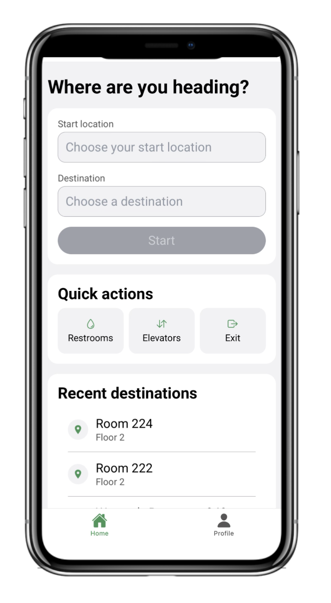
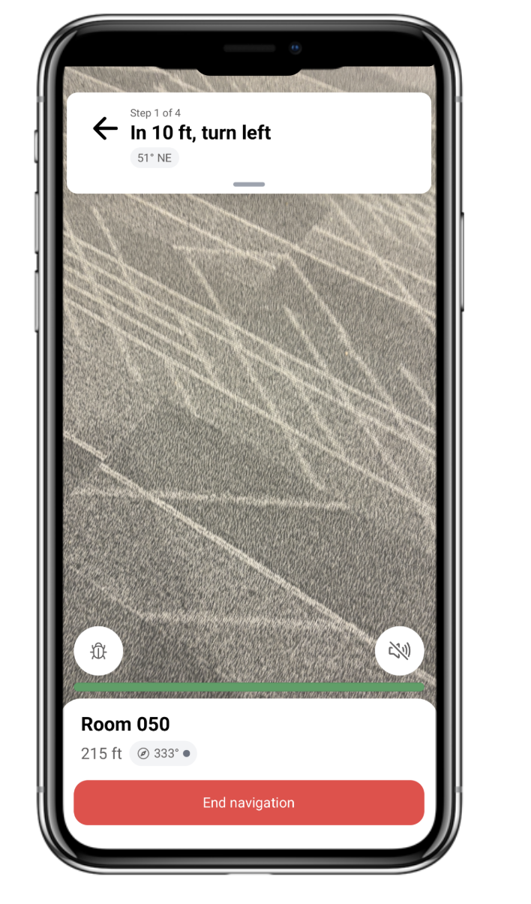

## Why we built it

As a sophomore, I kept getting lost in Purdue’s BHEE building. Its layout confuses almost every visitor. Then I realized how much harder it would be if I couldn’t see.

Stride gives visually impaired users turn-by-turn audio directions inside a building. It also warns them when people or objects get close, and it works with the accessibility features already on their phone.

## The system

We built an iOS and Android app on top of an AWS backend, with three external pieces: a map database, an inference server and a computer-vision model.

 

*Left: choosing a start and destination. Right: live navigation, with the current instruction on top and the distance to the destination at the bottom, shown over the camera feed used for collision detection.*

- **Static navigation:** a list of instructions from start to destination that the user can step through.
- **Live updates:** the phone’s pedometer moves the active instruction forward, with spoken feedback.
- **Collision detection:** a YOLOv11 detector plus distance estimation triggers haptic alerts.
- **Accessible sign-in:** minimal sign-up fields, biometric login and sessions through Cognito.

<figure class="flow" aria-labelledby="collision-cap">
  <ol>
    <li>Camera frame, every 500 ms</li>
    <li>API Gateway</li>
    <li>Object detection handler</li>
    <li>Inference server (YOLOv11)</li>
    <li>Distance estimate</li>
    <li>Haptic alert</li>
  </ol>
  <figcaption id="collision-cap">Collision-detection path. The app sends a camera frame every 500 ms through API Gateway to the object detection handler, which calls the YOLOv11 inference server, estimates distance and triggers haptic feedback. The requirement is to notify the user within 100 ms. I integrated this path into the backend; the model and inference server were built by teammates.</figcaption>
</figure>

## Navigation, which I led

### Mapping a building that had no measurements

The building manager had no floor measurements to give us, so I measured and sketched BHEE by hand, with a teammate’s help measuring. I turned those sketches into (x, y) coordinates and loaded them into a relational map database on AWS RDS (buildings, nodes, edges and landmarks), using Python and SQL with data-validation and automated deployment scripts. Coordinate transforms and bearing calculations turned the result into a routable graph: 76 nodes, 76 edges and 79 landmarks across 2 floors.

<figure class="flow" aria-labelledby="nav-cap">
  <ol>
    <li>Hand sketch</li>
    <li>(x, y) + validation</li>
    <li class="key">RDS map graph</li>
    <li>Lambda · Dijkstra</li>
    <li>Instructions + audio</li>
  </ol>
  <figcaption id="nav-cap">Navigation path. Hand-drawn floor sketches become validated (x, y) data in an RDS map graph. A Lambda runs Dijkstra on it, and the app reads out the resulting instructions.</figcaption>
</figure>

### Routing and orientation

A request to `/navigation/start` runs a Lambda that loads the relevant map data and computes the path with Dijkstra’s algorithm. The app first turns the user toward the first instruction. Every later turn is described relative to that starting heading.

### Taking the backend to production

I rebuilt the backend for production. It runs on Lambda, API Gateway (REST and WebSocket), RDS, IAM and CloudWatch, with the infrastructure defined in CDK. Every push builds and runs the unit tests, then deploys a separate dev stack for that branch on AWS. Merges to main deploy the production stacks automatically.

## Testing with users

We ran two rounds of user acceptance testing in BHEE with sighted and blindfolded participants.

<table>
  <caption>User acceptance testing</caption>
  <thead><tr><th scope="col">Detail</th><th scope="col">Round 1</th><th scope="col">Round 2</th></tr></thead>
  <tbody>
    <tr><th scope="row">Where</th><td>BHEE 2nd floor</td><td>BHEE ground floor</td></tr>
    <tr><th scope="row">Participants</th><td>3 (2 sighted, 1 blindfolded)</td><td>4 (2 sighted, 2 blindfolded)</td></tr>
    <tr><th scope="row">Tested</th><td>Instruction accuracy from a fixed start (room 208)</td><td>Live updates while walking, from a custom start</td></tr>
    <tr><th scope="row">Found</th><td>Swapped directions, a phantom turn</td><td>Voice off by default; dead reckoning drifts at corners</td></tr>
  </tbody>
</table>

### The fix between rounds: a new map schema

In round one, users were sent past their destination and then back to it. Door nodes sat on wall-aligned edges, away from the path people actually walk. I moved them to the hallway centerlines and added left/right metadata, and round two ran on that new schema.

  <figure>
    <figcaption>✕ Before: door node on the wall edge</figcaption>
    <svg role="img" aria-label="A hallway with the door node on the wall. The route passes the door, then doubles back to it." viewBox="0 0 300 150" fill="none">
      <rect x="10" y="50" width="280" height="50" stroke="currentColor" stroke-opacity="0.55" stroke-width="1.5"/>
      <path d="M20 75 H250 M250 75 H180 V50" style="stroke: var(--sec)" stroke-width="3" stroke-dasharray="8 5"/>
      <circle cx="180" cy="50" r="7" style="fill: var(--sec)"/>
      <text x="166" y="36" font-size="13" fill="currentColor" font-family="IBM Plex Mono, monospace">door</text>
    </svg>
  </figure>
  <figure>
    <figcaption>✓ After: centerline node with left/right</figcaption>
    <svg role="img" aria-label="The door node moved onto the hallway centerline and tagged left. The route stops at the door." viewBox="0 0 300 150" fill="none">
      <rect x="10" y="50" width="280" height="50" stroke="currentColor" stroke-opacity="0.55" stroke-width="1.5"/>
      <path d="M20 75 H180" style="stroke: var(--swe)" stroke-width="3"/>
      <circle cx="180" cy="75" r="7" style="fill: var(--swe)"/>
      <text x="146" y="36" font-size="13" fill="currentColor" font-family="IBM Plex Mono, monospace">door · left</text>
    </svg>
  </figure>

### What we changed from feedback

- After round 1, we removed the phone-number field from sign-up and added a full home screen between registration and the camera.
- After round 2, we turned voice assistance on by default. When dead reckoning becomes unreliable, the app now prioritizes collision detection.

## What I’d do next

### Onboard any building without hand-measuring

Mapping BHEE meant measuring every hallway by hand, which doesn’t scale past one building. I’d build an ingestion path that generates the navigation graph from a building’s existing floor plans, so a new building can be added without a site survey.

### Make the vision pipeline reliable in any lighting

Our sign detector was trained on 135 images from one building’s hallways. I’d broaden the training data across lighting conditions, from dim corridors to glare, so detection holds up wherever the app is used.

### Read room numbers faster and more accurately

Our two-stage pipeline, with YOLO finding the sign and EasyOCR reading it, extracted room numbers from 52.3% of sign crops at a median of about 614 ms per crop on CPU. I’d evaluate lighter scene-text recognition models to raise accuracy and cut that latency, so a user can rely on it while walking.
